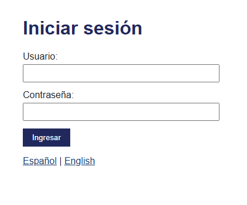
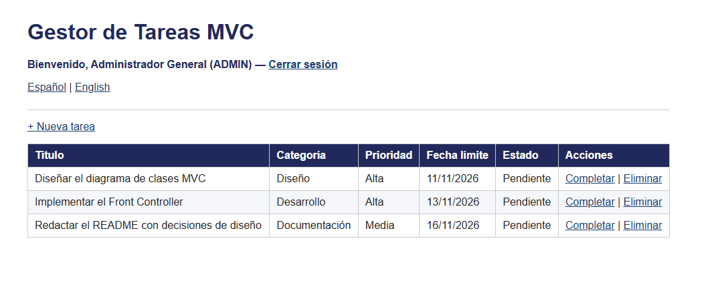
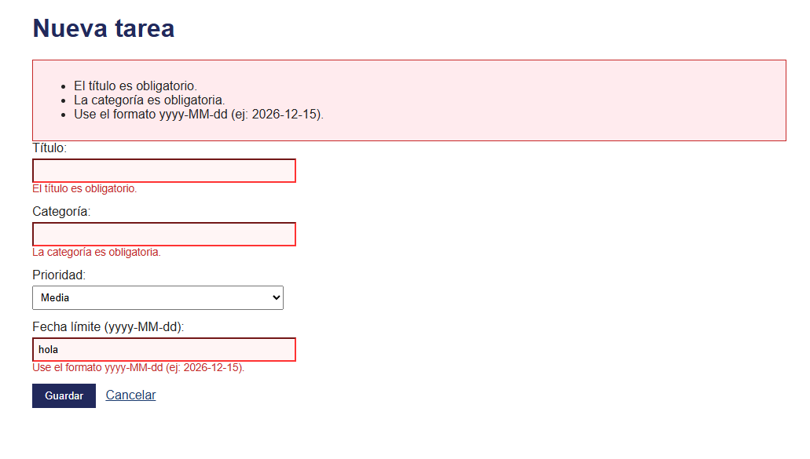
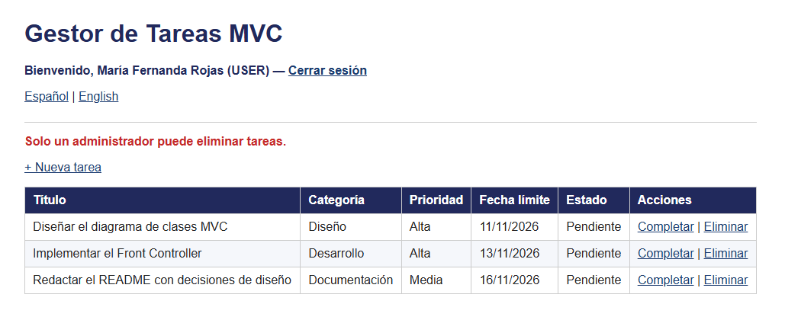
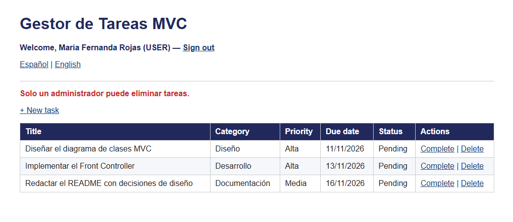

# Post-contenido — Unidad 6: JSP con MVC

**Autor:** Diego Alferez — Programación Web, UFPS

## Descripción

Repositorio del laboratorio de la Unidad 6 de Programación Web. Contiene un único
proyecto Maven Web (`gestor-tareas-mvc`) que formaliza el patrón MVC con un
**Front Controller** y el **patrón Comando**, extendido con autenticación por
sesión con roles, validación por campo e internacionalización.

## Prerrequisitos

- JDK 17 o superior (probado con JDK 21) en el PATH.
- Apache Tomcat 10.x (puerto 8080 disponible).
- Maven 3.8+.
- Git y cuenta de GitHub.
- IDE o editor: IntelliJ IDEA, Eclipse o VS Code.

## Estructura del proyecto

```
src/main/
├── java/com/ejemplo/mvc/
│   ├── model/        Tarea, TareaDAO, Usuario, UsuarioDAO
│   ├── service/      TareaService, AutenticacionService
│   └── controller/
│       ├── FrontControllerServlet.java   (único punto de entrada: /app)
│       └── comando/  Comando + ListarComando, FormularioComando, GuardarComando,
│                     EliminarComando, CompletarComando, LoginComando,
│                     LogoutComando, IdiomaComando
├── resources/        messages.properties, messages_en.properties, messages_es.properties
└── webapp/
    ├── index.jsp
    ├── css/estilos.css
    └── WEB-INF/      web.xml y views/ (login.jsp, lista.jsp, formulario.jsp)
```

## Parte 1 — Front Controller y patrón Comando

`FrontControllerServlet` es el único punto de entrada (`/app`) y delega en objetos
`Comando` (`ListarComando`, `FormularioComando`, `GuardarComando`,
`EliminarComando`, `CompletarComando`). `TareaService` y `TareaDAO` separan la
lógica de negocio y el acceso a datos del Controlador. Las vistas usan JSTL y
Expression Language, sin scriptlets. El CRUD de tareas aplica Post/Redirect/Get.

**Ejecución de la Parte 1:**

1. `mvn clean package`
2. Copiar `target/gestor-tareas-mvc.war` a `webapps` de Tomcat e iniciar Tomcat.
3. Abrir `http://localhost:8080/gestor-tareas-mvc/app`: se listan las 3 tareas
   precargadas; se puede crear, completar y eliminar tareas.

## Parte 2 — Sesión con roles, validación por campo e i18n

`FrontControllerServlet` centraliza la verificación de sesión antes de resolver
cualquier comando protegido. `LoginComando` y `LogoutComando` gestionan
`HttpSession` con roles `ADMIN` y `USER`; `EliminarComando` solo permite el rol
`ADMIN`. `GuardarComando` valida cada campo por separado, con mensajes
específicos y repoblado del formulario, usando la longitud máxima del título
leída del contexto de aplicación (`web.xml`). `IdiomaComando` guarda la
preferencia de idioma en una Cookie, que las vistas leen con el objeto EL
implícito `cookie` y `ResourceBundle` (`messages*.properties`).

**Ejecución de la Parte 2:** los mismos pasos de la Parte 1, e iniciar sesión en
`http://localhost:8080/gestor-tareas-mvc/app`.

| Usuario | Contraseña   | Rol   | Puede eliminar |
|---------|--------------|-------|----------------|
| admin   | Admin123!    | ADMIN | Sí             |
| maria   | Maria2026!   | USER  | No             |

## Decisiones de diseño

- **El Comando devuelve la vista lógica** (o `null` si ya hizo un redirect) en vez
  de invocar el `forward` directamente, para que `FrontControllerServlet`
  concentre esa llamada en un solo lugar y pueda aplicar lógica común.
- **Front Controller en vez de un Servlet por acción:** la verificación de sesión
  de la Parte 2 se agregó una sola vez, en `procesar()`, sin copiarla al inicio
  de cada Servlet. Un nuevo comando protegido queda cubierto automáticamente.
- **Verificación de sesión centralizada:** todos los comandos excepto `login` e
  `idioma` pasan por el mismo chequeo; sin sesión se redirige a `/app?comando=login`.
- **Cookie para el idioma, HttpSession para el usuario:** el usuario y su rol
  deben desaparecer al cerrar o expirar la sesión; el idioma debe sobrevivir al
  cierre de sesión (la pantalla de login ya se muestra en el idioma elegido).
- **Validación por campo:** `GuardarComando` acumula un mapa de errores (uno por
  campo), los muestra junto a cada campo y repuebla los valores ingresados.
- **Longitud máxima del título en el contexto de aplicación:** se lee de un
  `context-param` de `web.xml` (cargado una sola vez en `init()`), no de un
  literal en el código, para poder cambiar la regla sin recompilar.

## Cómo compilar y desplegar

1. Clonar el repositorio: `git clone https://github.com/diegoalferez/Alferez-post1-u6.git`
2. Abrir la carpeta como proyecto Maven (IntelliJ IDEA / VS Code).
3. Ejecutar `mvn clean package`.
4. Desplegar `target/gestor-tareas-mvc.war` en Tomcat 10.x (carpeta `webapps`)
   o configurar un Tomcat Server (Local) en el IDE con el artefacto `war exploded`.
5. Abrir `http://localhost:8080/gestor-tareas-mvc/app`.

## Capturas de pantalla

### Login


### Listado de tareas


### Formulario con validaciones por campo


### Restricción de rol al eliminar


### Selector de idioma

